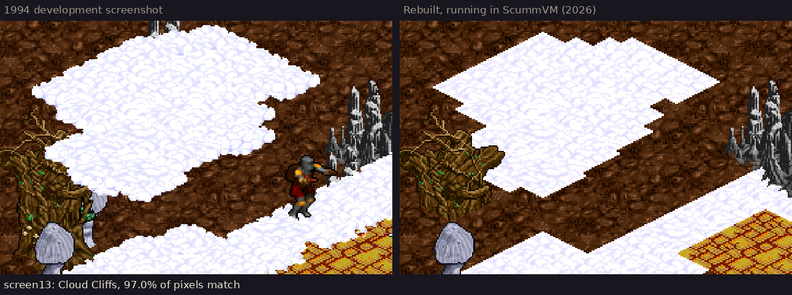
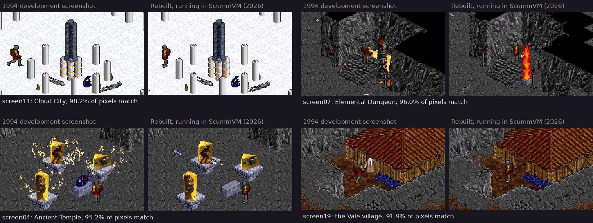
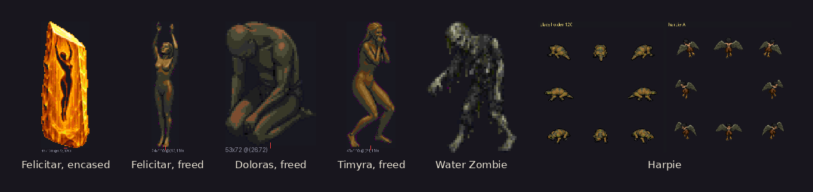
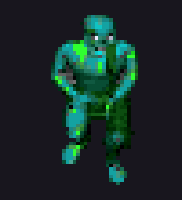
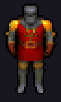
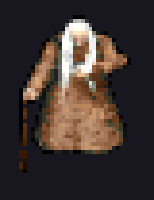
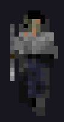
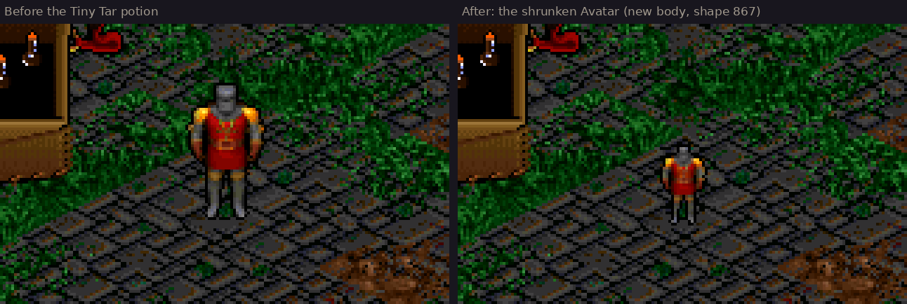
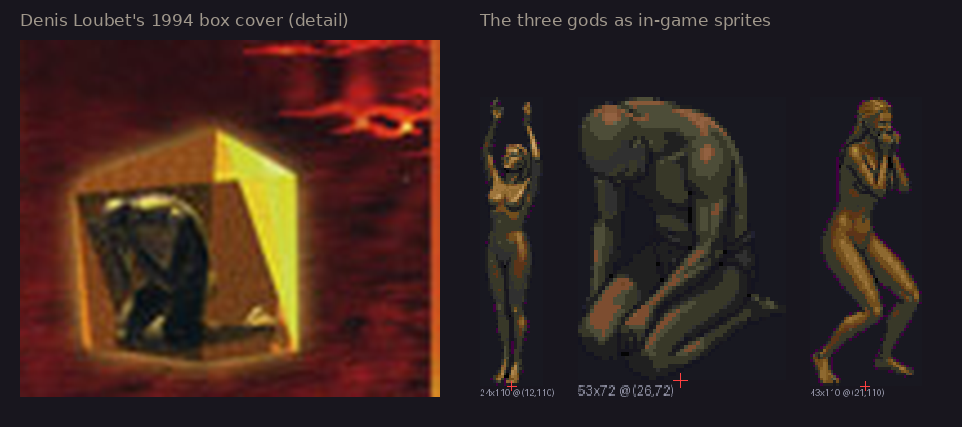
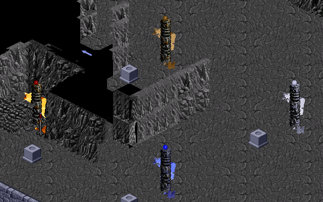

# Ultima 8: The Lost Vale, a fan restoration



*The Lost Vale* was the expansion to *Ultima 8: Pagan* that a small team at Origin
Systems finished in 1994. It was ready for duplication when Electronic Arts
cancelled it, and the disks were lost. What survived was a set of design documents,
19 screenshots, the box, and a diskette of usecode from one of its designers.

This is a hobby project I started in March 2026, mainly as an excuse to learn and
experiment with Claude Code. I wanted a large, messy, real problem to test AI coding
agents against, and I had always wondered whether the Lost Vale could be
reconstructed from the surviving screenshots and usecode. It runs in ScummVM against
your own copy of Ultima 8, and the full quest can be played start to finish.

It is very much a hobbyist experiment, so please take it in that spirit.

> **Preview release.** The 18-step quest plays end to end. The maps are a work in
> progress: they are playable, but outside the areas the 1994 screenshots show they
> still read as machine-generated. Nobody outside the project has tried the install
> steps yet, so bug reports are welcome.

## The 1994 screenshots, rebuilt

The 19 surviving screenshots are the only parts of the Lost Vale whose look is
actually known, so each one was rebuilt in place: every object identified, given world
coordinates, and placed in the maps. Captured in the running game, the rebuilt scenes
match the originals on 84% to 98% of their pixels, and 16 of the 19 reach 89% or
better (`docs/research/2026-10-16-screenshot-reconstruction/`).



## New art

Ultima 8 had no sprites for much of what the expansion needed. The gods, the new
monsters, and the Tiny Tar body are new; the elder and the spear-carrying children
were redrawn from the figures in the 1994 screenshots.



<p align="center">
  
  &nbsp;&nbsp;
  
  &nbsp;&nbsp;
  
  &nbsp;&nbsp;
  
  <br>
  <em>The Water Zombie, the Tiny Tar shrink, the village elder, and a Zealan child, in motion.</em>
</p>

Tiny Tar was a potion in the recovered code. Drinking it shrinks the Avatar so he can
slip through cracks the full-size Avatar cannot:



The box cover shows the three imprisoned gods, and the statues in the Inner Sanctum
were modeled on it:



Some of the new art came from GPT and Google image models: the three god statues, the
Harpie, the obelisk, and a few props. The models were shown retail Ultima 8 sprites,
the 1994 screenshots, and the box cover as references, and the build scripts reduced
the results to Ultima 8's palette and sprite format. `shared/docs/art-poc/` records
every prompt and every pick. A real artist replacing any of it would be welcome.



## What survived, and what this project adds

The sources:

- Three revisions of the plot and design documents, released through the Origin
  Museum and the Ultima Codex.
- A snapshot of 1994 usecode from Sheri Graner Ray's work diskette, recovered by
  Dominus Dragon and posted to the Ultima Dragons Discord in January 2025. Armitage's
  February 2025 analysis of it was this project's starting point.
- The 19 development screenshots, published on Dino's Guide to Ultima VIII.
- Developer interviews, and the 1994 production schedule.
- The Ultima 8 file formats as documented by the Pentagram project.

What this repository adds:

- **A usecode compiler** that turns 1994 `.UNK` source into Ultima 8 bytecode, with a
  disassembler, assembler, and round-trip validation against the retail game.
- **39 usecode source files:** 17 recovered 1994 files with documented repairs
  (`agents/usecode-compiler/src/lv-patched/`), and 22 new classes for the parts of
  the plot whose code was never recovered (`lv-new/`). The build compiles 53 in all;
  the rest come from your copy of the recovered archive.
- **Six new maps** (the Vale, Galjeron's Chamber, the Elemental Dungeon, the Cloud
  Cliffs, Cloud City, and the Ancient Temple) and changes to the Plateau and
  Tenebrae, built by scripts from the design documents and the 1994 screenshots.
- **A ScummVM engine patch** (`tools/scummvm-patches/`, 27 files) that adds the
  intrinsics and dialogue routing the recovered code needs, movement and NPC
  behavior fixes, debugger commands, and a larger archive entry limit.
  `build_scummvm.sh` adds the game's detection entry.

The 18-step main quest, from Lord British's vision to the Bag of Reagents, has been
completed with cheats off as one continuous save chain on two pinned builds in
October 2026 (`docs/playtest-2026-10-10-full-run-1-18.md` and the replay legs from
17 October). Development and testing happen on macOS and Linux. Windows is untested.

## What you need

1. **Ultima 8: Pagan** (the GOG *Gold Edition* is what this was built against).
2. **The recovered 1994 usecode**, `Sheri-U8-LV.zip`, posted by Dominus Dragon in the
   `#ultima-8-exult` channel of the Ultima Dragons Discord. The Ultima Codex
   [describes it here](https://ultimacodex.com/2025/02/a-look-at-the-usecode-for-ultima-8-the-lost-vale/).
3. **Python 3** (tested with 3.12) with Pillow and NumPy.
4. **A C++ toolchain, `make`, `pkg-config`, `unzip`, and SDL2** to build ScummVM:
   `brew install sdl2 pkg-config` on macOS, or
   `sudo apt install build-essential pkg-config unzip libsdl2-dev` on Debian or Ubuntu.
5. About 2 GB of disk (the ScummVM build is most of it), and patience: the game-file
   build takes several minutes, and one map alone takes about five.

The repository contains no Ultima 8 game files. The build reads your copy and writes
the merged files on your machine. Some 1994 material is included; `NOTICE.md` lists
it.

## Build and play

```bash
# 0. Python packages, in a virtual environment.
python3 -m venv .venv && . .venv/bin/activate
pip install -r requirements.txt

# 1. Put your game data where the build expects it (all of it is gitignored).
#    shared/data/u8-install/  the English DOS install: STATIC/, USECODE/, GAMEDAT/,
#                             SOUND/, SAVEGAME/, U8.EXE, ...
#                             (GOG macOS installer: pkgutil --expand-full <gog .pkg> /tmp/u8pkg
#                              and copy the English game folder from inside it)
#    shared/data/lv-usecode/  the unzipped Sheri-U8-LV.zip: LOST VALE/, U8/, UNK files/

# 2. Build the six game files and check them against the published hashes.
tools/build_artifacts.sh

# 3. Build ScummVM with the Lost Vale patch (first time, and after engine changes).
./build_scummvm.sh

# 4. Install and launch. Run this again whenever you want to play.
./install_lv.sh --run
```

Step 4 installs into a separate copy of your game, `shared/u8-lv-patched/`, and
launches ScummVM on it with its own settings file and save folder inside that copy.
Your original game folder, any Ultima 8 you already have set up in ScummVM, your
ScummVM settings, and your existing saves are left alone. Remove the copy with
`rm -rf shared/u8-lv-patched`.

If step 2 reports a hash mismatch, your game data probably comes from a different
release than the one the hashes were recorded against. Please open an issue with the
output. On Linux and Windows, extracting the GOG installer needs another tool; that
path is untested.

## How it was made

Nearly all the code was written by Claude Code and OpenAI Codex, with me steering,
reviewing, and playtesting. The project ran on one rule: nothing counts as done until
it has been exercised in ScummVM and the result written down, because the worst bugs
along the way were invisible to every static check and obvious after one click in the
game.

The written development record is in the repository:

- `PLAN.md` for the roadmap and its decisions, and `TODO.md` for live status.
- `agents/*/docs/` for each workstream's design notes and devlog.
- `docs/` for research notes, reviews, and dated playtest reports. The screenshots the
  reports refer to are kept out of this repository for size, so most of their image
  links are broken.
- `HANDOFF.md` for the session-to-session baton, and `CLAUDE.md` and `.claude/` for
  the instructions the agents worked under.

## Repository layout

- `agents/usecode-compiler/` compiler toolchain and the `.UNK` sources
- `agents/map-populator/` map builders, art injection, validators
- `agents/usecode-disasm/`, `agents/map-builder/`, `agents/npc-dialogue/`,
  `agents/corpus-builder/` earlier research phases and format specs
- `tools/` build, install, test, art, and playtest scripts
- `shared/corpus/` notes on the plot documents, interviews, and Pentagram docs
- `shared/build/` published hashes (`ARTIFACTS.sha256`) and pinned ids (`lv_manifest.json`)
- `docs/images/` the pictures on this page

`tools/run_all_tests.sh` runs the whole test suite (58 test files), and
`tools/cleanroom_test.sh` rebuilds everything from a fresh clone.

## Legal

This is a non-commercial fan project, and it is not affiliated with or endorsed by
Electronic Arts. *Ultima*, *Ultima 8: Pagan*, and *The Lost Vale* are trademarks of
Electronic Arts. You need your own copy of Ultima 8 to play. See `NOTICE.md` for what
the licenses cover and which files remain Origin's.

## Credits and license

See `CREDITS.md`. Code is GPL-3.0-or-later (`LICENSE`); documentation is CC BY 4.0;
details are in `NOTICE.md`. Happy to compare notes with anyone working on the Lost
Vale or on Ultima 8.
